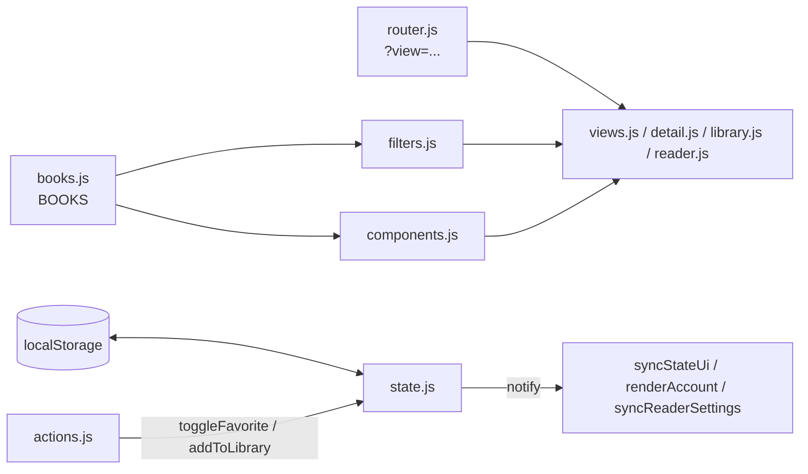

<div dir="rtl" align="right">

# 📚 کتاب‌سرا

**وب‌اپ فارسی و راست‌به‌چپ برای کشف، جست‌وجو و خواندن نمونهٔ کتاب — الهام‌گرفته از طاقچه**


پروژهٔ اول درس برنامه‌سازی وب — دانشگاه صنعتی شریف

</div>

---

<div dir="rtl" align="right">

## ✨ ویژگی‌ها

| بخش | چه کار می‌کند |
|---|---|
| 🏠 **صفحهٔ اصلی** | بنر معرفی، چیپ‌های دسته‌بندی و سه ردیف افقی (پیشنهادها، تازه‌ها، رایگان‌ها) با دکمه‌های قبلی/بعدی و لینک «مشاهده همه» |
| 🔎 **فهرست و جست‌وجو** | جست‌وجو در عنوان و نویسنده، فیلتر دسته‌بندی، فیلتر «فقط رایگان» و مرتب‌سازی؛ همهٔ فیلترها هم‌زمان و به‌صورت اشتراک شرط‌ها اعمال می‌شوند |
| 📖 **جزئیات کتاب** | جلد، نویسنده، دسته، امتیاز، توضیحات، کتاب‌های مرتبط و مسیر صفحه (breadcrumb)؛ هر کتاب آدرس مستقل و قابل اشتراک دارد |
| ❤️ **علاقه‌مندی‌ها** | افزودن/حذف از کارت یا صفحهٔ جزئیات؛ وضعیت در همهٔ نماها هماهنگ است |
| 🗂️ **کتابخانه** | کتاب‌های دریافت‌شده و علاقه‌مندی‌ها در دو بخش جدا، همراه با حالت خالی |
| 🧾 **دریافت و خرید نمایشی** | دریافت مستقیم کتاب رایگان و پنجرهٔ تأیید برای خرید نمایشی؛ جلوگیری از افزودن تکراری |
| 👤 **ورود نمایشی** | فقط نام و شمارهٔ موبایل (ارقام فارسی، عربی و لاتین)؛ بدون رمز و بدون سرور |
| 📱 **نمونه‌خوان** | متن چندبندی، سه اندازهٔ قلم و تم روشن/تیره؛ تنظیمات پس از Refresh حفظ می‌شود |
| ♿ **دسترس‌پذیری** | پرش به محتوا، Focus قابل‌مشاهده، برچسب برای فرم‌ها، `aria-live` برای پیام‌ها، پنجرهٔ `<dialog>` با Escape و بازگشت Focus، احترام به `prefers-reduced-motion` |

## 🚀 اجرا

پروژه **هیچ وابستگی‌ای ندارد**؛ نیازی به Node.js، npm، سرور یا اینترنت نیست.

1. فایل ZIP را استخراج کنید.
2. فایل **`index.html`** را در یک مرورگر مدرن باز کنید (دابل‌کلیک کافی است).

> اگر خواستید با یک سرور محلی اجرا کنید (اختیاری):
> ```bash
> python -m http.server 8000
> # سپس http://localhost:8000 را باز کنید
> ```

**مسیر شروع:** `index.html`


### 🧹 پاک کردن وضعیت ذخیره‌شده

همهٔ وضعیت برنامه (کاربر، علاقه‌مندی‌ها، کتابخانه، تنظیمات مطالعه) فقط در `localStorage` و زیر کلید `ketabsara:state:v1` ذخیره می‌شود. برای بازگشت به حالت اولیه:

1. در مرورگر `F12` را بزنید.
2. تب **Console** را باز کنید و این دستور را اجرا کنید:
   ```js
   localStorage.removeItem("ketabsara:state:v1"); location.reload();
   ```
3. یا از مسیر **Application ← Local Storage** کلید بالا را حذف کنید.

## 🗂️ ساختار پوشه‌ها

```text
book-web-hw1/
├── index.html          # اسکلت صفحه (هدر، main، فوتر) و بارگذاری اسکریپت‌ها
├── css/
│   └── style.css       # همهٔ استایل‌ها، متغیرهای رنگ، تم نمونه‌خوان، ریسپانسیو
├── js/
│   ├── books.js        # تنها منبع داده: آرایهٔ BOOKS و CATEGORIES
│   ├── utils.js        # کمکی‌ها: el()، فرمت اعداد فارسی، نرمال‌سازی ارقام، ساخت URL
│   ├── filters.js      # منطق خالص جست‌وجو، فیلتر و مرتب‌سازی (بدون DOM)
│   ├── storage.js      # خواندن/نوشتن امن localStorage
│   ├── state.js        # State مرکزی + اعتبارسنجی + سیستم subscribe
│   ├── actions.js      # دکمه‌های علاقه‌مندی/دریافت، پیام وضعیت، پنجرهٔ خرید
│   ├── components.js   # کارت کتاب، ردیف افقی، بنر، دسته‌ها، نوار فیلتر
│   ├── detail.js       # صفحهٔ جزئیات و کتاب‌های مرتبط
│   ├── library.js      # صفحهٔ کتابخانه
│   ├── reader.js       # نمونه‌خوان و تنظیمات مطالعه
│   ├── auth.js         # فرم ورود نمایشی و اعتبارسنجی
│   ├── router.js       # مسیریاب ساده بر پایهٔ ?view=…
│   ├── views.js        # نماهای صفحهٔ اصلی، فهرست و «یافت نشد»
│   └── app.js          # ثبت مسیرها، اشتراک در State و شروع برنامه
└── assets/
    ├── images/covers/  # جلد کتاب‌ها (book-01 تا book-12)
    └── fonts/          # فونت ایران‌سنس (محلی)
```

## 🧠 معماری

برنامه یک **SPA سبک** است که بدون هیچ کتابخانه‌ای ساخته شده. جریان داده یک‌طرفه است: داده ← State ← رابط.



اصول اصلی:

- **یک منبع حقیقت برای داده:** همهٔ نماها از آرایهٔ `BOOKS` ساخته می‌شوند؛ هیچ کارتی دستی نوشته نشده است.
- **یک نقطهٔ تغییر State:** فقط `state.js` وضعیت را تغییر می‌دهد. بعد از هر تغییر، ذخیره در `localStorage` و اطلاع‌رسانی به نماها خودکار است؛ بنابراین کارت، صفحهٔ جزئیات و کتابخانه همیشه هماهنگ‌اند.
- **امنیت DOM:** هیچ‌جا از `innerHTML` استفاده نشده؛ متن کاربر و داده فقط با `textContent` درج می‌شود.
- **منطق خالص جدا از UI:** `filters.js` و اعتبارسنجی ورود بدون DOM نوشته شده‌اند و جداگانه قابل تست‌اند.

## 🧭 مسیرها (URL)

| آدرس | نما |
|---|---|
| `index.html` | صفحهٔ اصلی |
| `?view=catalog` | فهرست کتاب‌ها |
| `?view=catalog&q=…&category=…&free=1&sort=…` | فهرست با فیلتر ترکیبی |
| `?view=book&id=book-05` | جزئیات کتاب |
| `?view=reader&id=book-05` | نمونه‌خوان |
| `?view=library` | کتابخانهٔ من |
| `?view=login&next=…` | ورود نمایشی (با بازگشت به صفحهٔ قبلی) |

مقادیر مجاز `sort`: `price-asc` · `price-desc` · `rating`

شناسهٔ نامعتبر یا نمای ناشناخته، پیام روشن و لینک بازگشت نشان می‌دهد؛ `next` در ورود فقط روی لیست سفیدِ آدرس‌های داخلی پذیرفته می‌شود.

## 🔍 منطق جست‌وجو

ترتیب پردازش: **جست‌وجو ← فیلتر ← مرتب‌سازی** (`getCatalogBooks` در `filters.js`).

- فاصلهٔ ابتدا و انتهای عبارت حذف می‌شود.
- مقایسه بدون حساسیت به حروف لاتین، و با یکسان‌سازی «ي/ك» عربی با «ی/ک» فارسی و حذف نیم‌فاصله انجام می‌شود.
- جست‌وجو روی **عنوان** و **نام نویسنده** انجام می‌شود.
- فیلتر دسته و رایگان هم‌زمان اعمال می‌شوند (AND).
- مرتب‌سازی روی یک **کپی** از نتیجه اعمال می‌شود و آرایهٔ اصلی هرگز تغییر نمی‌کند.
- پارامترهای نامعتبر در URL نادیده گرفته می‌شوند.

## 💾 منطق ذخیره‌سازی

کلید `ketabsara:state:v1` با ساختار زیر:

```js
{
  favoriteBookIds: ["book-03"],
  libraryBookIds: ["book-01"],
  currentUser: { name: "علی", phone: "09123456789" },   // یا null
  readerSettings: { fontSize: "medium", theme: "light" } // small|medium|large , light|dark
}
```

- در شروع، داده خوانده و **فیلد به فیلد اعتبارسنجی** می‌شود (`sanitizeState`): شناسهٔ ناموجود، تکراری یا نوع نادرست حذف می‌شود و فیلد خراب به مقدار امن پیش‌فرض برمی‌گردد.
- JSON خراب، `null`، آرایه یا رشته باعث Crash نمی‌شود.
- خروج از حساب فقط `currentUser` را پاک می‌کند؛ کتابخانه و علاقه‌مندی‌ها می‌مانند.
- اگر مرورگر `localStorage` را مسدود کند، برنامه با حافظهٔ معمولی ادامه می‌دهد.

## 👤 قوانین ورود نمایشی

- نام نمایشی نباید خالی باشد.
- شماره باید **دقیقاً ۱۱ رقم** و با **`09`** شروع شود.
- ارقام فارسی (`۰۹۱۲…`)، عربی (`٠٩١٢…`) و لاتین پذیرفته و به لاتین نرمال می‌شوند.
- پیام خطا کنار همان ورودی نمایش داده می‌شود (`role="alert"`، `aria-invalid`).
- دریافت کتاب بدون ورود ممکن نیست و کاربر به صفحهٔ ورود هدایت می‌شود.
- هیچ رمز یا اطلاعات حساسی دریافت یا ذخیره نمی‌شود.

## 🧪 چک‌لیست تست دستی

- [ ] جست‌وجوی عنوان، نویسنده و عبارت دارای فاصلهٔ اضافه
- [ ] ترکیب دسته + رایگان + مرتب‌سازی (هر سه حالت)
- [ ] جست‌وجوی بدون نتیجه و بازگشت از آن
- [ ] باز کردن آدرس جزئیات در تب جدید و Refresh
- [ ] شناسهٔ نامعتبر (`?view=book&id=xyz`)
- [ ] ورود نامعتبر (نام خالی، شمارهٔ کوتاه/بلند، بدون `09`) و ورود معتبر با ارقام فارسی
- [ ] دریافت کتاب رایگان، خرید نمایشی، و دریافت دوباره (نباید تکراری شود)
- [ ] علاقه‌مندی کردن/حذف و ماندگاری پس از Refresh
- [ ] نمونه‌خوان: سه اندازهٔ قلم، دو تم، Refresh
- [ ] کتاب بدون نمونه (`book-01` یا `book-02`)
- [ ] خراب کردن دستی `localStorage` و اطمینان از Crash نشدن
- [ ] عرض‌های `360`، `768` و `1440` پیکسل و پیمایش با صفحه‌کلید

## ⚠️ محدودیت‌های شناخته‌شده

- فیلترها و مرتب‌سازی با دکمهٔ «اعمال» (ارسال فرم GET) انجام می‌شوند، نه به‌صورت زنده.
- تم تیره فقط روی **نمونه‌خوان** اعمال می‌شود، نه کل سایت.
- دکمه‌های قبلی/بعدی ردیف‌ها در عرض ≤ ۶۰۰px پنهان‌اند و پیمایش با کشیدن انگشت یا صفحه‌کلید انجام می‌شود.
- خواندن کامل کتاب و EPUB پشتیبانی نمی‌شود (طبق صورت تمرین لازم نبود).


| مورد | منبع / مجوز |
|---|---|
| فونت ایران‌سنس | … |
| تصاویر جلد (`assets/images/covers/`) | … |
| توضیحات کتاب‌ها | … |
| متن نمونه‌ها (`sample`) | … |

- **درس:** برنامه‌سازی وب — دانشگاه صنعتی شریف

</div>
